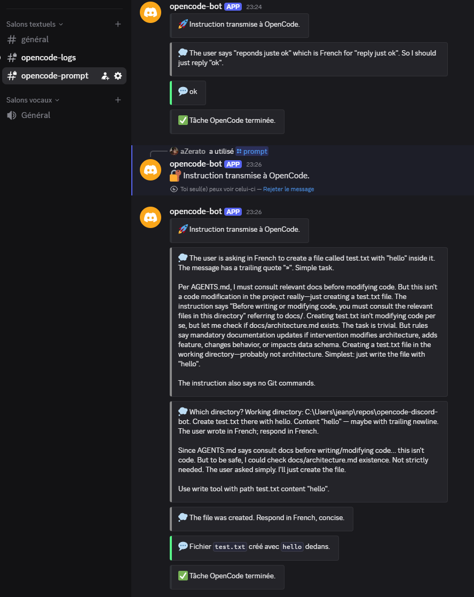
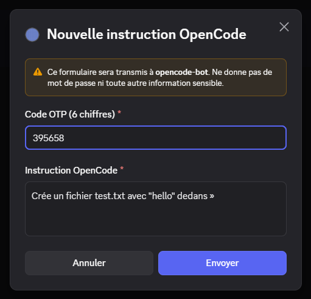
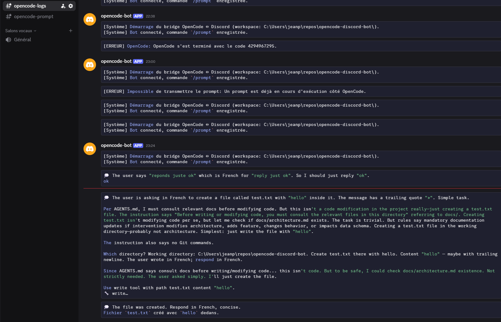

# OpenCode Discord Bot

Pont **bidirectionnel et sécurisé** entre une instance locale d'OpenCode et un serveur Discord privé.

Le bot permet de :

- **Suivre à distance** l'exécution d'OpenCode : les logs sont envoyés dans `#logs` (batching anti rate-limit, nettoyage ANSI, blocs `` ```bash ``).
- **Répondre aux questions** d'OpenCode (validations, choix…) publiées dans `#prompt` — boutons **Oui/Non** si la question est binaire, sinon réponse en citant le message.
- **Soumettre de nouveaux prompts** depuis Discord, sous **authentification OTP** (TOTP compatible Microsoft/Google Authenticator).

Vous pouvez controler votre instance opencode via discord en tapant `/prompt`,



Une fenêtre avec un OTP vous permettra de soumettre votre demande,



Vous avez une idée du status de votre bot / instance dans un canal dédié,



## Stack

Node.js v20+ · TypeScript (strict) · discord.js v14 · otplib · qrcode · zod · strip-ansi · dotenv

## Prérequis

- **Node.js v20+** et `npm`.
- Le CLI **OpenCode** installé et fonctionnel (`opencode run "test"`).
- Un **bot Discord** créé, présent sur votre serveur privé, avec les intents `Guilds`, `GuildMessages` et **`Message Content`** (intent *privilégié* à activer dans le portail développeur Discord), et les permissions d'envoyer des messages / insérer des embeds / réagir dans les canaux concernés. Configuration pas-à-pas : voir [`docs/discord.md`](docs/discord.md).
- Deux canaux texte : `#logs` et `#prompt`.

## Installation

```bash
# 1. Installer les dépendances
npm install

# 2. Préparer la configuration
cp .env.example .env   # Windows : copy .env.example .env

# 3. Générer le secret OTP (affiche un QR Code + l'URI otpauth://)
npm run setup:otp
```

Scannez le QR Code avec **Microsoft Authenticator** (ou Google Authenticator), puis remplissez le fichier `.env` :

```env
# Discord
DISCORD_BOT_TOKEN=votre_token_bot
DISCORD_GUILD_ID=id_du_serveur
DISCORD_LOG_CHANNEL_ID=id_du_canal_logs
DISCORD_PROMPT_CHANNEL_ID=id_du_canal_prompt

# Sécurité
ALLOWED_DISCORD_USER_ID=votre_id_utilisateur_discord   # seul utilisateur autorisé
OTP_SECRET=secret_base32_genere_par_setup_script

# OpenCode
OPENCODE_WORKSPACE_PATH=/chemin/vers/votre/projet
LOG_FLUSH_INTERVAL_MS=3000
```

## Commandes

| Commande              | Description                                                        |
| --------------------- | ---------------------------------------------------------------- |
| `npm run dev`        | Lance le bot directement depuis TypeScript (tsx), sans build     |
| `npm run build`      | Compile vers `dist/`                                             |
| `npm start`          | Lance le bot compilé (`node dist/index.js`)                      |
| `npm run typecheck`  | Vérification TypeScript sans émission                            |
| `npm run setup:otp`  | Génère un secret TOTP : QR Code + URI + secret à coller dans `.env` |

## Utilisation

### Répondre aux questions d'OpenCode (`#prompt`)

Quand OpenCode demande une validation ou un choix, le bot publie un embed dans `#prompt` :

- **Question binaire** → boutons **Oui** / **Non**.
- **Autre question** → répondre en **citant (reply)** le message.

La réponse est réinjectée dans OpenCode.

### Soumettre un prompt (3 façons, OTP obligatoire)

1. **Inline (crochets)** : `!run [123456] Crée un composant React…`
2. **Inline (préfixe)** : `123456: Crée un composant React…`
3. **Slash command** : `/prompt` → modale sécurisée (code OTP + instruction).

À la validation : le message contenant l'OTP est **supprimé** (hygiène sécurité), une réaction ✅ confirme, et le prompt est transmis à OpenCode.

> 🔒 Sécurité : vérification TOTP avec fenêtre de tolérance de 1 pas, et **verrouillage 5 minutes après 3 échecs consécutifs**. Tout utilisateur non autorisé est ignoré silencieusement.

## Structure

```
src/
├── config/env.ts              # Validation Zod des variables d'env
├── core/
│   ├── OpenCodeAdapter.ts     # Abstraction OpenCode (spawn CLI) + EventEmitter typé
│   └── LogBatcher.ts          # Buffer + flush (toutes les 3 s ou 1800 caractères)
├── discord/
│   ├── client.ts              # Client discord.js + envoi par ID de canal
│   ├── commands/promptModal.ts# /prompt + modale OTP
│   └── handlers/
│       ├── logChannel.ts      # Découpe >1950 caractères + envoi dans #logs
│       └── promptChannel.ts   # Flux A (questions) + Flux B (prompts OTP)
├── security/otpService.ts     # otplib + anti brute-force
├── scripts/setup-otp.ts       # Génération du secret + QR Code
└── index.ts                   # Orchestration (arrêt propre SIGINT/SIGTERM)
```

## Documentation

- L'architecture de référence, les flux de données et les spécifications détaillées : [`docs/architecture.md`](docs/architecture.md).
- La configuration Discord pas-à-pas (création de l'application, intents, invitation, permissions, remplissage du `.env`, dépannage) : [`docs/discord.md`](docs/discord.md).
